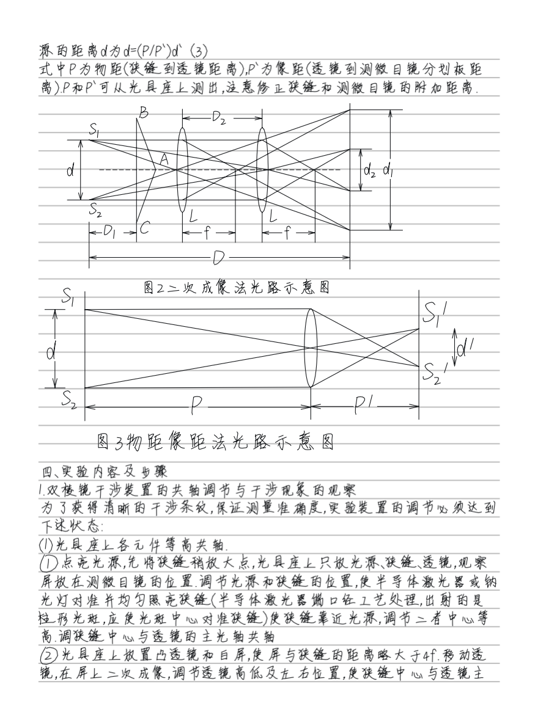
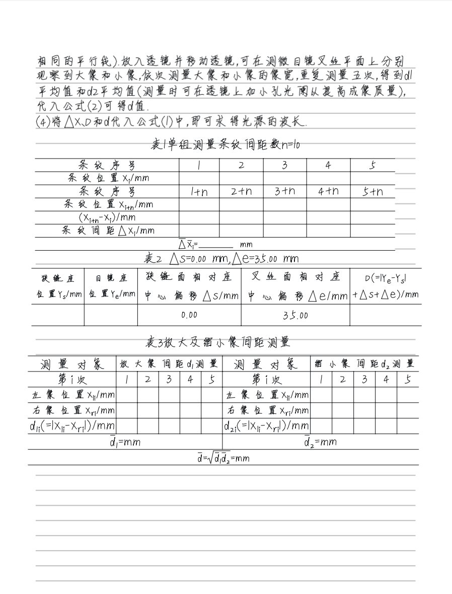
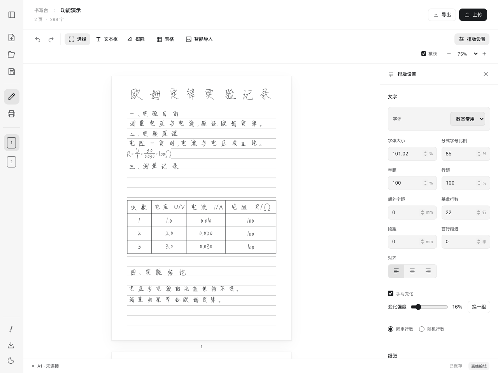
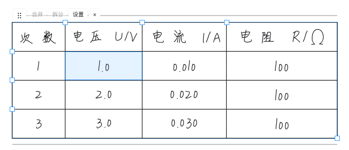
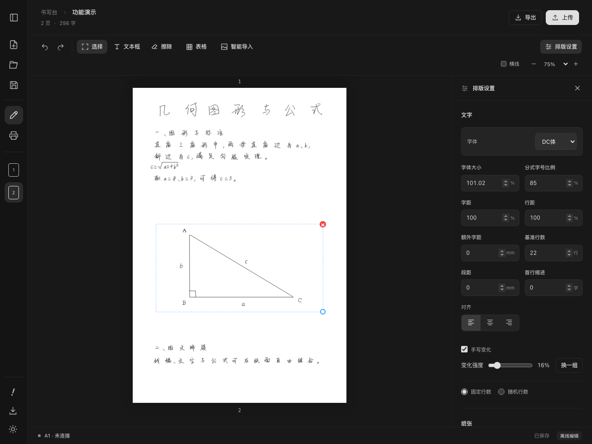

# BambuScribe Write

面向 macOS Apple Silicon 的拓竹 A1 手写助手：在纸面编辑文字、公式、表格与图片，生成 G-code，并通过局域网上传到打印机。

[下载 1.0.1](https://github.com/ICEIU-I/BambuScribe-Write/releases/tag/v1.0.1) · [操作说明](desktop/README.md) · [输入规则](desktop/docs/writing-syntax.md) · [反馈问题](https://github.com/ICEIU-I/BambuScribe-Write/issues)

## 成品展示

**双棱镜干涉实验教案 · 两页节选**

同一份教案中，手写正文、数学公式、带标注的光路图与实验记录表格共同排版。下图展示完成后的页面效果，点击图片可查看原图。

| 光路图、公式与实验步骤                                                                                                                              | 测量表格与数据记录                                                                                                                          |
| --------------------------------------------------------------------------------------------------------------------------------------------------- | ------------------------------------------------------------------------------------------------------------------------------------------- |
| [](docs/images/finished-optics-diagrams.png) | [](docs/images/finished-optics-tables.png) |

## 功能展示

以下为 1.0 系列的实际界面与软件预览，使用专门制作的演示内容。图片可点击放大。

### 手写排版与实时预览

在纸面直接编辑正文，自动分页并调整页面顺序。内置“教案专用”和“DC体”两套手写字库，可调字体大小、字距、行距、纸张边距和手写变化强度。正文支持上下标、分式、根号、上横线及独立公式。



### 可编辑表格与文本框

表格中的文字可以直接修改，支持合并与拆分单元格、调整行高列宽、拖动和缩放。标题、说明与公式也可以放入独立文本框，与正文一起排版；编辑支持复制、撤销与重做。



### 图片线稿与图文混排

将图片转换为可书写的线稿，与文字、公式组合排版；可以移动、缩放图片，并用框选或自由擦除修整笔画。下图展示 DC体、根号与上下标，以及深色主题下的图文排版。



### 从编辑到 A1 书写

- **保存与导出**：以 `.ccf` 保存可继续编辑的项目，逐页导出 G-code，或将全部页面打包为 ZIP。
- **设备与上传**：管理多台设备，通过局域网连接 A1，选择页面并批量上传；书写启停与换纸在打印机端操作。
- **智能导入**：可选的表格、图像和数据处理导入，需自行配置模型服务与 API Key。
- **命令行**：[CLI](desktop/docs/cli.md) 支持项目编辑、校验、预览、导出和设备调用。

## 安装与使用

需要 M 系列 Mac、macOS 13 或更新版本。打开 DMG，将应用拖入 Applications；也可解压 ZIP 安装。应用使用临时签名，尚未经过 Apple 公证，首次打开方法见[安装说明](desktop/releases/INSTALL.txt)。

字库、排版、预览及系统 OCR 可离线使用；智能导入需要自行配置模型服务和 API Key。个人项目、打印机访问码和模型配置只保存在本机，不随源码或安装包提供。

连接 A1 前，请安装笔架、开启 LAN 模式及固件支持的开发者模式，完成归零、笔尖定位与抬落笔高度校准。先用短句试写；缺字或坐标越界会阻止输出。客户端负责上传，书写的启动、暂停、停止和换纸在 A1 端操作。

## 开发

需要 Go 1.25+、Node.js 22.12+、Xcode Command Line Tools。首次运行：

```sh
git clone https://github.com/ICEIU-I/BambuScribe-Write.git
cd BambuScribe-Write
go install github.com/wailsapp/wails/v2/cmd/wails@v2.16.0
export PATH="$(go env GOPATH)/bin:$PATH"
cd desktop
wails dev
```

构建应用：

```sh
cd desktop
wails build -platform darwin/arm64 -trimpath
```

构建会安装前端依赖、生成 Wails 绑定并编译前端。产物为 `desktop/build/bin/BambuScribe Write.app`。完整检查及贡献流程见 [CONTRIBUTING.md](CONTRIBUTING.md)，发布步骤见[发布文档](desktop/docs/releases.md)。

## 目录

| 目录                                  | 内容                            |
| ------------------------------------- | ------------------------------- |
| `desktop/frontend`                    | Vue 界面、状态与交互测试        |
| `desktop/internal/engine`             | 字库、排版、公式、图像与 G-code |
| `desktop/internal/application`        | 桌面接口与文件操作              |
| `desktop/internal/printer`            | 发现、MQTT、FTPS 与上传         |
| `desktop/internal/project`、`storage` | 项目格式与本地配置              |
| `desktop/internal/updater`            | 版本检查与安装更新              |
| `desktop/cmd`、`tools`                | CLI 与开发工具                  |
| `desktop/docs`、`releases`、`scripts` | 使用说明、发布记录与打包脚本    |

从 1.0.0 起，源码、安装包和问题反馈统一在本仓库。旧下载仓库只保留历史文件和 1.0.0 过渡包；0.1.1–0.1.8 可在应用内检查更新，升级后自动使用本仓库。0.1.0 请手动安装。

## 许可与来源

本项目基于 [Animesh-Varma/BambuScribe](https://github.com/Animesh-Varma/BambuScribe)，按 [GPL-3.0](LICENSE) 分发。内置“教案专用”和“DC体”由 [ICEIU-I](https://github.com/ICEIU-I) 原创制作，按同一许可证分发；依赖和来源见 [THIRD_PARTY_NOTICES.md](THIRD_PARTY_NOTICES.md)。每个版本的完整源码可在对应发布页下载。
